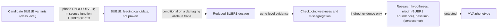

# AIREA — MVA Hackathon 2026, Track 2 (Drug Repurposing): detailed report

**Team:** AIREA. **Status:** final draft for the team's submission; the team still has to approve it. Not yet submitted.

**What this report is.** It proposes approved-drug **research hypotheses** for mosaic variegated aneuploidy (MVA), based on a mechanism-first analysis of the participant's genetic data. In line with the competition's framing, "submissions are hypotheses for follow-up, not evidence that a medicine works".
- **It is not** a diagnosis, a clinical variant classification or a treatment recommendation, and **no dose is proposed**.
- **No experiment was performed.**

**Acknowledgement** (required by the Official Rules):

> "This work was made possible through the Hackathon, organized by Sage Bionetworks in partnership with the MVA Society, Hugging Face, and BEACON (The Benchmarking, Evaluation, and Assessment Consortium for Science), with prize sponsorship from AWS and Anthropic. We are deeply grateful to the child and their family who generously contributed their data and their story to advance research into this rare disease. We acknowledge their trust in making this Hackathon possible."

**Licence.** Under the Official Rules, participant submissions, code and reports are released under CC BY 4.0. The repository is licensed CC BY 4.0 (`../LICENSE`; scope in `../NOTICE.md`). Third-party material cited here keeps its own licence (section 18).

**Privacy.** This report describes the participant's variants **by class only**. It contains no genotype, read-level value, coordinate, variant notation, allele frequency, sample identifier, phenotype list or secondary finding (section 14).

## Contents

1. Executive summary
2. Abstract
3. Research question, scope and objectives
4. Biological and clinical context
5. Data provenance and dataset characteristics
6. Methods
7. Results by stage (K2–K6)
8. Characterisation of the variant mechanism
9. Evidence for and against each material conclusion
10. Phase and functional-evidence limitations
11. From mechanism to drug hypotheses
12. Proposed experiments and decision points
13. Validation, reproducibility and checksums
14. Privacy, ethics and AI-use disclosure
15. Limitations, unavailable evidence and analyses not performed
16. Conclusions and future work
17. Repository and submission notes
18. References

Annexes: A. Methods-form answers · B. Rubric and template mapping · C. Evidence labels

## 1. Executive summary

- **Leading mechanism.** Reduced BUBR1 dosage (loss of function) through **BUB1B**. The data contain:
  - a known truncating BUB1B allele: an exact-allele ClinVar Pathogenic/Likely pathogenic record with multiple submitters, predicted to trigger nonsense-mediated decay (NMD);
  - a rare BUB1B **missense change of unknown function**;
  - a deep-intronic BUB1B variant of uncertain significance.

  MVA1 is recessive, so the explanation needs a **second damaging allele in trans**.
- **What is not established:**
  - phase (cis or trans) cannot be resolved from any existing data;
  - the missense change cannot be classified as damaging;
  - TRIP13, CEP57 and CENATAC cannot be ranked against each other;
  - an intronic CEP57 structural signal is unresolved.

  BUB1B is therefore the **leading candidate, not a proven cause**.
- **Drug hypotheses.** Twelve candidates were assessed as five-link causal chains, with FDA/EMA status verified and a deterministic ranking rule. **None has direct evidence of MVA-relevant benefit**, and no drug-repurposing recommendation is supported. Two approved drugs remain **indirect research hypotheses**:
  - **niacin:** NAD+/SIRT2-dependent BUBR1 abundance; relevant only if residual BUBR1 protein exists;
  - **dasatinib:** clearance of senescent cells; downstream and gene-agnostic.
- **Decisive next evidence.** The phase of the two BUB1B variants, and the function of the missense change. Their outcome **changes the drug choice** (section 11.4). The minimal experimental programme to address missense function is specified in section 12.
- **What the approach offers beyond this case.**
  - Each evidence item carries a label: measured, database-observed, predicted, indirect, hypothesis or unknown.
  - Technical validity, function and causality are kept apart.
  - A locus-targeted read-recovery method is used.
  - The drug-ranking rule is deterministic and re-derivable.
  - Each candidate has explicit falsification criteria.

## 2. Abstract

*(285 words; identical to the methods-form answer for question A17.)*

We evaluated approved-drug hypotheses for mosaic variegated aneuploidy (MVA) using a participant's whole-genome data, with a mechanism-first approach.

**Variant analysis.** We re-analysed the data at read level (locus-targeted realignment, robustness tests against control heterozygous sites from the same sample, coding callability, structural screens and a phase review). It supports a known truncating BUB1B allele, but it cannot classify a second, rare BUB1B missense change or resolve phase. A biallelic BUB1B mechanism is therefore conditional. Three other MVA genes (TRIP13, CEP57, CENATAC) showed no coding loss of function and could not be ranked against each other, and an intronic CEP57 structural signal remains unresolved.

**Drug assessment.** Twelve previously curated candidates were each tested as a causal chain from drug to target, cellular process, disease mechanism and phenotype. FDA/EMA status was verified, supporting and contradicting literature was recorded, and a documented deterministic ranking rule was applied. No candidate has direct evidence of MVA-relevant benefit. Two approved drugs remain plausible but indirect research hypotheses:
- dasatinib (senescent-cell clearance, a downstream effect);
- niacin (NAD+/SIRT2-dependent BUBR1 abundance, relevant only if residual BUBR1 protein exists).

Antioxidants, proteasome inhibition and spindle poisons are contradicted or potentially counterproductive. Read-through is weak, given the predicted nonsense-mediated decay.

**Experiments.** We provide falsifiable in-vitro designs that separate rescue from growth inhibition, and a minimal functional programme for the missense change. Its interpretation is limited by the scarcity of classified pathogenic BUB1B missense controls.

**Strengths:** explicit uncertainty; evidence labels on every claim; traceable sources with recorded access levels; a pre-declared ranking rule.

**Limitations:**
- literature mostly read at abstract level;
- unresolved phase and missense function;
- no wet-lab data;
- validation scripts written by the same AI assistant as the analyses.

The hypotheses are for follow-up and do not demonstrate efficacy.

## 3. Research question, scope and objectives

**Question.** Which existing, market-approved medications could plausibly target the pathway disrupted in this case? And how strong is the chain of evidence from the participant's variants to each drug?

**Scope:**
- **Drugs:** market-approved medications only. Combinations are allowed if every component is approved and justified; investigational agents are out of scope.
- **Genes:** four MVA genes, BUB1B, TRIP13, CEP57 and CENATAC, with alternative explanations kept open.
- **Evidence:** public data and literature only, apart from the organiser dataset.

**Objectives:**
1. Characterise the variant mechanism: loss or gain of function, pathway, downstream consequence.
2. Establish what the sequencing data can and cannot show.
3. Assess each drug as an explicit causal chain.
4. State which future result would change the drug choice.
5. Specify falsifiable experiments.

## 4. Biological and clinical context

This section is kept at the level permitted for public release.

- **The condition.** MVA is a rare recessive disorder of constitutional mosaic aneuploidy with cancer predisposition [3]. MVA1 is caused by biallelic BUB1B variants: typically a null allele with a missense or non-coding second allele [3–6].
- **BUBR1's role.** BUB1B encodes BUBR1, a component of the spindle assembly checkpoint. It also supports kinetochore–microtubule attachment, through the KARD motif and recruitment of PP2A-B56 by the pseudokinase domain [7, 8].
- **Dosage.** Reduced BUBR1 abundance or function causes chromosome missegregation. MVA missense mutants in or near the kinase domain show high protein turnover [6]. Allelic effects in mice extend "beyond protein level" [9].
- **Other MVA genes:**
  - TRIP13: MAD2 remodelling;
  - CEP57: centrosome and pericentriolar material;
  - CENATAC: minor-spliceosome AT-AN intron retention.
- **Gene–disease validity (GenCC [31]):** BUB1B and CEP57 Definitive; TRIP13 Strong to Limited; CENATAC Limited.
- **Treatment.** No approved therapy is directed at the gene defect of any of the four genes. No US drug label lists MVA.

## 5. Data provenance and dataset characteristics

| Item | Description |
|---|---|
| Source | Organiser-provided, gated single-sample whole-genome dataset (small-variant VCF and paired-end FASTQ files), used under the Hackathon Rules and Data Transfer Agreement. Not redistributed. |
| What is absent | Parental or family samples, RNA, cytogenetics, linked or long reads |
| What the VCF shows | Variant sites only (no reference blocks), so a missing record says nothing about coverage. No structural-variant, copy-number or mobile-element calls. Only short-range read-backed phase sets, which do not cover the BUB1B candidates. |
| Phenotype | A team-supplied phenotype summary was used at gene level only, to compare the four genes and keep alternative explanations open. It is not reproduced here. |
| Reference data | GRCh38 no_alt_plus_hs38d1 analysis set (GCA_000001405.15); Ensembl release 116 [34]; MANE v1.5 [30]; UniProt release 2026_03 [35]; gnomAD v4.1.1 genomes and exomes (regional reads) with v4.0 exome coverage [29]; ClinVar GRCh38 VCF release of 2026-10-04 [28]; AlphaFold DB model v6 of BUBR1, wild type [26, 27] |

**Limitations of the data:**
- one sample;
- short reads only;
- phase information that does not reach the candidates;
- no RNA, so no test of splicing or NMD in patient cells.

## 6. Methods

### 6.1 Workflow

| Stage | Question | Main output |
|---|---|---|
| K2 | What do literature and databases say about the four genes, the candidate variants and approved drugs? | Gene-level review, four-gene comparison, competing hypotheses, drug review, evidence ledger |
| K3 | Are the candidate calls technically real, and could a second allele be hidden? | Read-level robustness, coding callability, structural screens, sensitivity analysis |
| K4 | Can phase be resolved? What could the missense change do? What is the CEP57 signal? | Phase review, mechanism comparison (M0–M6), structural-signal assessment |
| K5 | Does any approved drug have evidence of MVA-relevant benefit? | Causal-chain assessment of 12 candidates, ranking rule, experiment designs |
| K6 | Is there functional evidence for any variant, and which experiments would be informative? | Functional-evidence categories, assay-validity review, minimal programme |

### 6.2 Read-level re-analysis (K3, K4)

**Locus-targeted read recovery** was used instead of a whole-genome alignment.

1. **Pass 1.** Every read pair was aligned with `bwa mem` [32] to a locus reference: BUB1B ±250 kb, then TRIP13, CEP57 and CENATAC ±100 kb. A pair was kept when either mate had ≥ 60 aligned bases with edit distance NM ≤ 2. This keeps clipped and discordant reads.
2. **Pass 2.** The kept pairs were realigned to the full analysis set.
3. **Processing:** sorted and indexed with samtools [33]; `fixmate` and `markdup` for the three-locus screen.
4. **Re-calling:** `bcftools mpileup -q 20 -Q 13 -a AD,DP` piped to `bcftools call -m` [33].

**Robustness tests:**
- ten pre-declared read-level tests per candidate (strand, read position, mapping and base quality, local context and others), compared with **252 control heterozygous SNVs** from the same sample;
- a **32-combination grid**: mapping quality {0, 20, 40, 60} × base quality {0, 13, 20, 30} × duplicates kept or removed;
- an independent re-call;
- flank mappability (`bwa mem -a`).

**Other analyses:**
- **Coding callability:** each MANE coding sequence ±10 bp at depth ≥ 20.
- **Structural screens:** depth runs, discordant and split-read clusters.
- **Homozygosity:** runs of homozygosity and local heterozygosity.
- **Phase review:** reads, fragments, supplementary alignments, phase tags, barcodes, family data, panels.

**Tools:** bwa 0.7.17-r1188, samtools 1.19.2, bcftools 1.19 and the Python 3.12.3 standard library. Nothing else was installed.

### 6.3 Annotation and transcript checks

- **REF and normalisation:** REF checked against the analysis set; left-normalisation with bcftools.
- **Transcript effect:** re-derived on the MANE Select transcript from Ensembl 116 exon models.
- **NMD expectation:** the exon-junction-complex rule: a stop more than 50 nt upstream of the last exon–exon junction is expected to trigger NMD [2]. This is a prediction.
- **Population frequency:** exact allele matching after normalisation. Differently represented equivalents were not reconciled.

### 6.4 Literature and database evidence (K2–K6)

**Literature:**
- Europe PMC queries used generic gene, drug and process terms only.
- Abstracts were read as raw API text. Full text was read only where open access was available and stated (section 18).
- In K2, external pages (for example GenCC) went through a summarising web-fetch tool, so those reads are summaries of the page. Load-bearing sources were later re-read as raw text.

**Regulatory status:**
- openFDA (`drugsfda`, `label`), whose data are unvalidated by its own disclaimer;
- EMA EPAR pages and a 2026-10-20 EMA medicines-report snapshot [36].

**ClinVar:** neighbourhood and gene-wide missense counts on the MANE protein.

**Paralog alignment:** BUBR1 against BUB1 (local Smith–Waterman with BLOSUM62).

### 6.5 Drug-hypothesis ranking (K5)

Each candidate was assessed over five links:
- **L1:** drug → target;
- **L2:** target → cellular process;
- **L3:** process → disease mechanism;
- **L4:** mechanism → MVA phenotype;
- **L5:** dependence on which gene or variant hypothesis is true.

Categories come from a deterministic rule over criteria C0–C7. The first match wins:

| Order | Condition | Category |
|---|---|---|
| 1 | Not approved | out of scope |
| 2 | Opposing target relation, perturbing direction, or a major disease-aligned contradiction | contradicted or potentially counterproductive |
| 3 | Direct or regulator relation, the drug itself tested in an MVA-gene model, no major harm | stronger mechanistic hypothesis |
| 4 | Direct, regulator or downstream relation, genetic or related-compound evidence in an MVA-gene model, no major harm | plausible but indirect |
| 5 | Target relation and support both unknown | unrankable |
| 6 | Otherwise | weak/nonspecific |

The full criteria table is in `DRUG_HYPOTHESIS_ASSESSMENT.md`.

### 6.6 Functional-evidence framework (K6)

The ClinGen SVI recommendations for PS3/BS3 (Brnich et al. [1], read in full text) were applied in four steps:
1. disease mechanism;
2. assay classes;
3. validity of specific assays (controls, replication, statistics);
4. application to the variant.

No PS3/BS3 strength was assigned to any proposed experiment.

### 6.7 Exclusion and decision rules

- **No numeric gene scores:** no scoring model with known performance exists for this question.
- **Absence of a report is not counter-evidence:** a missing literature report is never counted against a hypothesis.
- **Rarity is not pathogenicity.**
- **No transfer between alleles:** classifications are not carried over to other alleles.
- **Evidence-exclusion sensitivity analysis:**
  - S1: remove abstract-only literature;
  - S2: remove single-submitter assertions;
  - S3: remove indirect evidence;
  - S4: all three.
- **Pre-declared rule kept on record:** the CEP57 classification rule was pre-declared. A documented deviation from it is reported, not hidden (section 7.3).

### 6.8 Analyses not performed

| Analysis | Reason |
|---|---|
| Statistical phasing | No reference panel or map; singleton allele; it would give a misleading probability |
| Orthogonal confirmation (e.g. Sanger) | Needs new patient material, outside the Hackathon terms |
| Family, long-read or linked-read phasing | No such data |
| Splice prediction | No predictor installed; installs not authorised |
| Conservation beyond one paralog | No local alignment; downloads not authorised |
| Repeat classification or assembly of the CEP57 signal; structural-variant population lookup | Tools or database unavailable; an external lookup would expose a position |
| gnomAD lookup of the TRIP13, CEP57 and CENATAC records | Needed an approved regional read; not done |
| Mutant structure modelling and ΔΔG | Formal **no-go**: licence eligibility unconfirmed, data licence unverified, method error not established |
| Full-text reading of most key papers | Not open access |
| Any wet-lab experiment | Designs only |

## 7. Results by stage

Each result carries its evidence label (Annex C).

### 7.1 K2: literature, mechanism and competing genes

**Four-gene comparison:**

| Criterion | BUB1B | TRIP13 | CEP57 | CENATAC |
|---|---|---|---|---|
| Gene–disease validity *(database-observed)* | Definitive AR (MVA1) | Strong to Limited AR (MVA3) | Definitive AR (MVA2) | Limited AR (MVA4); one submitter, one report |
| Loss-of-function-class allele in the data *(measured)* | Yes: known truncating allele | None | None | None |
| Candidate second variant *(measured)* | Rare missense (unclassified); deep-intronic VUS (single-submitter ClinVar record) | None | None; one unresolved intronic signal | None; the variant is a missense change only on a non-MANE isoform |
| Order | First, by completeness of mechanism only | Not rankable against the others | Not rankable | Not rankable |

**Contradictions recorded** *(indirect)*:
- inheritance: one database entry suggests dominant inheritance, against the recessive consensus;
- the BUBR1 pseudokinase role: catalytic versus structural [7];
- TRIP13 allelic heterogeneity;
- two case reports that are a probable duplicate, counted as one case.

**Approved therapies:** none directed at any of the four genes' defects. Disease-context drugs (dactinomycin, vincristine, somatropin) are not MVA-directed.

### 7.2 K3: read-level re-analysis

- **Robust calls.** The three BUB1B candidate calls are technically real in this sample *(measured)*:
  - they pass all ten pre-declared tests against 252 controls;
  - genotypes are stable across all 32 grid combinations;
  - an independent re-call agrees, and flank mapping is unique.

  No orthogonal assay was available, so a technical artefact is **weakened, not excluded**.
- **No coding loss of function** in TRIP13, CEP57 or CENATAC. Each MANE coding sequence is ≥ 99% callable at depth ≥ 20, with no zero-depth base *(measured)*. Non-coding, regulatory and structural alleles remain open.
- **No run of homozygosity** at the four genes, and heterozygous calls in every gene body *(measured)*.
- **BUB1B second-allele search:**
  - no copy-number-like depth change of about 1 kb or more;
  - no insertion-like or retrocopy pattern.

  Insertions, balanced events and the deep-intronic variant remain **unresolved** *(measured; unknown)*.
- **Structural screens of the other genes:**
  - TRIP13: the depth signal is technically uninterpretable (subtelomeric noise);
  - CEP57: one new intronic signal;
  - CENATAC: nothing in the gene body.
- **The CENATAC call** is supported but has artefact-associated features (strand bias; next to a homopolymer). It does not affect the gene comparison, because it is deep intronic on the MANE transcript.
- **Population data.** The absence of homozygotes for the truncating allele in gnomAD is **uninformative**: at its frequency, Hardy–Weinberg expects far fewer than one *(database-observed; computed)*.
- **Sensitivity analysis.**
  - The gene order is unchanged under S0–S4, and no hypothesis changes status.
  - One basis changes: every item supporting a damaging missense change is indirect. With S3, the BUB1B model rests only on the truncating allele plus the mere presence of the missense change.
- **Filter-dependent findings**, none of which affects the BUB1B findings or the gene order:
  - CENATAC call robustness;
  - TRIP13 depth runs;
  - the classification of weak discordant clusters;
  - the matching of some indel and low-depth records.

### 7.3 K4: phase, missense mechanism and the CEP57 signal

- **Phase cannot be resolved from any existing data** *(measured; unknown)*. Statistical phasing was deliberately not run. The truncating and missense positions are close enough in the mRNA for a single cDNA molecule to span both, so RNA could phase them directly *(predicted)*.
- **Missense mechanisms.** The change lies in a confidently modelled, partly buried turn of the wild-type AlphaFold model. No mutant model was built. **No mechanism is asserted:**

| ID | Mechanism | Evidence status |
|---|---|---|
| M0 | No material effect | Not excluded |
| M1 | Reduced stability or faster turnover | Most indirect support: class-level turnover of kinase-domain MVA missense alleles [6]; conformational sensitivity of the pseudokinase domain [7]; buried position (wild-type model only) |
| M2 | Altered regulation by phosphorylation | Speculative |
| M3 | Impaired pseudokinase-domain function (KARD phosphorylation, PP2A-B56) at normal abundance | Speculative; the domain is required for this function [8] |
| M4 | Altered catalytic or ATP-related activity | Weakly contradicted: catalysis is dispensable in human BUBR1 [7] |
| M5 | Altered splicing via a new exonic motif | Speculative |
| M6 | An effect only in trans with a null allele, or only in some tissues | Hypothesis (recessive dosage model) |

- **The CEP57 signal is unresolved** *(measured; unknown)*.
  - **Insertion-like features:** a two-sided clip pile-up from independent fragments with unique sequence.
  - **Artefact-like features:** a repetitive partner that also collects mates from unrelated loci; no poly-A; no unique junction.
  - **Rule deviation:** the pre-declared rule said artefact-leaning, but its only triggering criterion is confounded with real repeat insertions; the deviation is documented.
  - **Even if real,** the signal is intronic and heterozygous, with no second CEP57 allele.
- **The ranking is unchanged.**

### 7.4 K5: drug-repurposing assessment

| Category | Candidates |
|---|---|
| Stronger mechanistic hypothesis | none |
| Plausible but indirect | dasatinib; niacin |
| Weak/nonspecific | gentamicin; dactinomycin; somatropin |
| Contradicted or potentially counterproductive | acetylcysteine; bortezomib; vincristine; microtubule poisons, Aurora and PLK1 inhibitors |
| Out of scope (not approved) | NMN, nicotinamide riboside and nicotinamide; ataluren; dasatinib + quercetin |

- **No direct evidence:** no candidate has direct evidence of MVA-relevant benefit. *(unknown; first-page searches: an absence of record, not evidence of absence)*
- **No candidate has all five links supported.** None has the mechanism-to-phenotype link (L4) supported by direct MVA evidence. The full link grid is in `DRUG_HYPOTHESIS_ASSESSMENT.md`.
- **Reclassification:** niacin was moved from "rejected" in the earlier curated review to "plausible but indirect" by the documented criteria. This adds no evidence of benefit.

### 7.5 K6: functional variant assessment

- **No direct functional evidence** exists for any of the participant's variants *(unknown)*.
- **Missense neighbourhood in ClinVar:** in a small window around the change, all but one missense record is of uncertain significance and one is benign/likely benign; none is pathogenic. A published disease-reported missense nearby in the same domain [9] is itself VUS in ClinVar *(database-observed)*.
- **Gene-wide controls:** ClinVar lists 1 Likely pathogenic BUB1B missense variant (single submitter) and 35 benign/likely benign ones *(database-observed)*.
- **Calibration barrier.** Brnich et al. require at least 11 pathogenic and benign controls in total for moderate evidence without rigorous statistics [1]. Any assay of the missense change can therefore be **research-calibrated only**.
- **Paralog:** the wild-type residue is identical in BUB1. This is a weak signal; there is no cross-species conservation data *(computational)*.
- **Published experiments:**
  - none tested the participant's variants;
  - those on other alleles were read at abstract level only [6, 9, 10] and cannot be graded.
- **Result:** no PS3 or BS3 code applies to any variant.

## 8. Characterisation of the variant mechanism

The competition asks for this explicitly: loss or gain of function, the pathway disrupted, and the downstream consequence.

| Question | Answer | Basis |
|---|---|---|
| Loss or gain of function? | **Loss of function (dosage)** for BUB1B. There is no evidence or rationale for gain of function or a dominant-negative effect; carriers of one null allele are reportedly unaffected. | Truncating allele: NMD predicted [2] plus an exact-allele ClinVar P/LP record [28]. Missense: unclassified. Recessive model [3–6] |
| Pathway disrupted | The spindle assembly checkpoint and kinetochore–microtubule attachment (BUBR1 in the mitotic checkpoint; KARD-mediated PP2A-B56 recruitment) | Gene-level literature [6–8] |
| Downstream consequence | Chromosome missegregation, leading to constitutional mosaic aneuploidy; cancer predisposition is part of MVA | Gene-level literature [3, 6, 9, 11] |
| Conditions for this mechanism to hold in this case | Both: the missense change (or deep-intronic variant) is damaging, **and** it is in trans with the truncating allele | Section 10 |
| Status | **Conditional, not established** | Sections 9–10 |

**Direction this sets for any drug:** restore BUBR1 dosage or function, or compensate downstream, and **never further perturb mitosis**.

## 9. Evidence for and against each material conclusion

| Conclusion | Supporting | Contradicting or limiting | Strength |
|---|---|---|---|
| BUB1B is the leading candidate | Only gene with a loss-of-function-class allele plus candidate second variants; Definitive validity | Phase unknown; missense function unknown; the order reflects completeness of mechanism, not probability of causation | Conditional |
| The truncating allele is a loss-of-function allele | Exact-allele ClinVar P/LP (multiple submitters); NMD prediction; class-level evidence | Not directly demonstrated (no RNA) | Strong expectation, not demonstrated |
| The missense change is damaging | Indirect only: class-level turnover [6]; a disease-reported neighbour in mice [9]; buried wild-type position; paralog identity | Its ClinVar neighbourhood is mostly VUS; the disease-reported neighbour is VUS in ClinVar; no direct data; "no effect" possible | **Unresolved** |
| The two BUB1B variants are in trans | — | No data can phase them | **Unresolved** |
| TRIP13, CEP57, CENATAC are not implicated by coding loss of function | ≥ 99% coding callability; no coding loss of function; no run of homozygosity | Non-coding and structural alleles not excluded; TRIP13 depth uninterpretable | Weakened, not excluded |
| The CEP57 signal is a real insertion | Two-sided independent clip pile-up | Repetitive partner, no poly-A, no unique junction | **Unresolved** |
| Niacin could raise BUBR1 | NAD+/SIRT2 maintain BubR1 in mice; NMN raised BubR1 [15]; nicotinic acid raises blood NAD+ in humans [16] | Niacin itself untested on BubR1; needs residual protein; progenitor exposure unknown; muscle and liver warnings | Plausible but indirect |
| Dasatinib could help | Genetic senescent-cell clearance delays ageing-type phenotypes in BubR1 progeroid mice [13]; BubR1 insufficiency raises senescence markers in mice [12]; dasatinib is senolytic in some cells [14] | No dasatinib data in any BUBR1 model; does not address missegregation; senescence restrains tumours [13]; paediatric growth warnings | Plausible but indirect |
| Read-through (gentamicin) could restore BUBR1 | Read-through in cystic fibrosis [17, 18] | The allele is predicted NMD-sensitive, and NMD governs the response [19]; the ataluren class failed in phase 3 [20]; boxed toxicity | Weak |
| Antioxidants are inadvisable | Antioxidants accelerate tumour progression and metastasis in mice [23, 24] | Antioxidant benefit for aneuploidy-related instability in cells or flies [21, 22] | Contradicted (safety) |
| Spindle poisons are inadvisable | They induce chromosome missegregation [25] | — | Contradicted (wrong direction) |

## 10. Phase and functional-evidence limitations

- **Phase.** Short reads cannot link the two BUB1B variants. There are no family samples, no linked or long reads, and no RNA. Statistical phasing is not applicable. Phase therefore stays **unknown**. New patient material is outside the Hackathon terms, and no variant-specific request was made to the organisers.
- **Function.** There are no direct data. The only pathogenic missense control in ClinVar is far below the framework's minimum. Abstract-level access prevents grading published experiments, and mutant structure modelling was not performed (no-go).
- **Sequencing confidence ≠ function ≠ causality:**

| Variant | Is the call real? | Does it change function? | Does it cause disease here? |
|---|---|---|---|
| Truncating allele | High (measured) | Loss of function expected, not demonstrated | Not established; needs a second damaging allele in trans |
| Missense change | High (measured) | Unresolved | Not established; needs functional evidence and trans phase |

## 11. From mechanism to drug hypotheses

### 11.1 Why these candidates, and the ranking logic

- **Origin:** the candidates came from a curated review. No automated drug–target screen generated them.
- **Ranking:** a deterministic rule ranks them (section 6.5). The full criteria and five-link grid are in `DRUG_HYPOTHESIS_ASSESSMENT.md`.
- **Surviving hypotheses:** they keep the direction set in section 8.
  - **Niacin** aims to *restore* BUBR1 abundance through a known regulator.
  - **Dasatinib** aims to *compensate* downstream by removing senescent cells.

### 11.2 Surviving hypotheses

The full cards are `DRUG_EVIDENCE_CARD_NIACIN.md` and `DRUG_EVIDENCE_CARD_DASATINIB.md`.

| | Niacin (nicotinic acid) | Dasatinib |
|---|---|---|
| Regulatory status (checked 2026-10-24) | FDA approved (ANDAs); EMA central products withdrawn | FDA approved (NDA and ANDAs); EMA Sprycel authorised |
| Proposed link to the mechanism | NAD+ → SIRT2-dependent BUBR1 deacetylation → BUBR1 abundance → fewer segregation errors [15, 16] | Removing BUBR1-insufficiency-associated senescent cells [13, 14] |
| Depends on | A BUB1B mechanism **and** residual BUBR1 protein (wild type, or a hypomorphic missense in trans) | Gene-agnostic; not on the participant's variants |
| Main counterevidence | Never tested on BubR1; blood NAD+ only; progenitor exposure unknown | No BUBR1-model data; does not fix missegregation; may remove tumour-restraining senescence |
| Safety (label sections read) | Skeletal muscle and liver warnings | Effects on growth and development in paediatric patients; multi-kinase toxicity |
| Status | Research-only hold; **no dose proposed** | Research-only hold; **no dose proposed** |

### 11.3 Rejected or deprioritised candidates

| Candidate | Category | Reason |
|---|---|---|
| Gentamicin | Weak | Read-through of a stop codon, but the allele is predicted NMD-sensitive; efficacy evidence is in cystic fibrosis only [17–19]; boxed toxicity |
| Dactinomycin, somatropin | Weak | Not MVA-directed; somatropin carries neoplasm-risk warnings |
| Acetylcysteine | Contradicted | Tumour promotion [23, 24] |
| Bortezomib | Contradicted | No evidence of BUBR1 stabilisation; expected to perturb mitosis (source unverified); severe toxicity |
| Vincristine; microtubule, Aurora and PLK1 inhibitors | Contradicted | Increase missegregation [25] |
| NMN/nicotinamide riboside/nicotinamide; ataluren; dasatinib + quercetin | Out of scope | Not approved, or an unapproved component |

### 11.4 Which genetic result changes the drug choice

| If the genetic results show… | Niacin | Dasatinib | Gentamicin |
|---|---|---|---|
| Truncating allele in trans with a hypomorphic missense | **Most relevant** | Ageing-type features only | Only if transcripts escape NMD |
| Missense is a functional null in trans | Little benefit expected | As above | As above |
| Variants in cis, or missense benign | Irrelevant | Only if MVA has another cause | Irrelevant |
| TRIP13, CEP57 or CENATAC causal | Irrelevant | Possibly (gene-agnostic); no evidence | Irrelevant |

## 12. Proposed experiments and decision points

**All of these are designs; none was performed.** Full designs are in `FUNCTIONAL_TEST_DESIGNS.md`.

| Experiment | Question | Design (summary) | Decision it informs |
|---|---|---|---|
| B1 + C1 (first) | Does the missense change lower BUBR1 abundance, turnover or checkpoint function? | Isogenic knock-in panel: missense/missense, missense/null, WT/null, WT/WT; ≥ 2 clones, ≥ 3 replicates; benign-neighbour and provisional disease references; degron null; blinded imaging | **Reduced abundance (M1):** strengthens the BUB1B model and prioritises D2 (niacin). **WT-like in B1 and C1:** weakens the missense as a second allele, and BUB1B-directed drugs lose priority. |
| A1 | Does the deep-intronic variant alter splicing? | Minigene in two cell lines with positive and negative controls | **Positive:** an alternative second allele, and BUB1B-directed ideas regain relevance. **Negative:** weak evidence against, because the native context is missing. |
| A3 | Does a stop of the truncating type trigger NMD? | Engineered stop, with and without NMD inhibition | **Escape from NMD:** read-through (D3) gains relevance |
| D2 niacin | Does nicotinic acid raise BUBR1 through SIRT2? | BUBR1-hypomorphic cells; SIRT2-loss and K668-mutant controls; NAPRT check | **Abolished by SIRT2 loss, or no BUBR1 change:** reject |
| D1 dasatinib | Can senolysis occur without more missegregation? | BUBR1-insufficient cells; dose–response; missegregation per division in survivors | **More errors or transformation markers:** reject |
| D3 gentamicin | Is full-length BUBR1 produced? | Engineered stop, with and without NMD inhibition | **No product at non-toxic doses:** reject (pre-declared stop rule) |

**What would change the prioritisation most:**
- phase (it needs new material);
- B1/C1 results for the missense change;
- for TRIP13, CEP57 or CENATAC: evidence of a second allele, which would make niacin irrelevant.

## 13. Validation, reproducibility and checksums

**Validation of the computations:**
- each stage ran a script that recomputed key results by separate code paths (K2 12 checks, K3 15, K4 13, K5 11, K6 10; all pass);
- a separate audit of K2 corrected one overstated gene-level statement and documented smaller issues (`METHODS.md`).

**The same AI assistant wrote the analyses and the validation scripts.** These checks show **internal consistency, not independent validation**.

**Checksums:**
- every stage package was checksummed and re-verified before later use, with zero mismatches;
- files without a checksum manifest are recorded as unverified, not as verified.

**Reproducibility:**
- tools, versions, parameters and reference releases are in section 6 and `METHODS.md`;
- the drug categories can be re-derived by hand from the published criteria;
- re-running the patient-level analyses needs the organiser's dataset under its terms;
- the analysis scripts are held privately because they embed restricted inputs (section 17).

**Compute:**
- one workstation;
- the largest step, the three-locus read screen, took about 4.6 hours;
- all tools are free.

**Scalability:**
- locus-targeted read recovery, evidence labelling and the deterministic causal-chain rule all apply to other genes, candidate lists and cases.

## 14. Privacy, ethics and AI-use disclosure

**Privacy:**
- **Data use** follows the Hackathon Rules: no redistribution; no recontact of the data subject, family or MVA Society contacts; deletion of all data within 30 days of Hackathon close, confirmed to the organisers.
- **This report** contains no information that could re-identify the data subject or family. Variants are described by class; no phenotype list is given; no secondary or incidental finding is reported.

**Ethics:**
- the study operates under the organisers' IRB-approved protocol;
- the team did not contact the family or clinicians.

**AI use** (disclosure required by the competition):

| Item | Disclosure |
|---|---|
| Provider, product and model | Anthropic, Claude Pro (consumer subscription), used through Claude Code with the model Claude Opus 5.5 |
| Data-handling setting | Model-training opt-out enabled ("Help improve Claude" off); no feedback or ratings given on outputs (team-confirmed). Whether any content was flagged for safety review is not visible to users. |
| What was processed | Command output, including variant-level information from the participant's data, was processed by this cloud service. Raw data files were not uploaded as files, but variant-level details did reach the service through tool output. |
| Organiser guidance applied | Consumer tiers are permitted for patient-specific or derived information if model training is opted out and no feedback is given (organiser guidance, 2026-09-28, Community discussion #2). Provider, tier and setting are documented as requested. |
| How AI was used | Analysis scripting, public-API literature and regulatory retrieval, evidence tabulation, drafting of reports, and writing the validation scripts |
| Human responsibility | The team directed the work, made the scope and disclosure decisions, and is responsible for the content |

## 15. Limitations, unavailable evidence and analyses not performed

- **Genetics:**
  - phase unresolved;
  - missense function unclassified;
  - the deep-intronic variant untested;
  - the CEP57 signal unresolved;
  - no cytogenetics, so it is unknown whether the cellular phenotype is MVA;
  - low-level mosaicism and parental origin unknown;
  - short-read and locus-recovery blind spots (insertions, balanced events, highly divergent sequence).
- **Evidence access:**
  - most literature at abstract level;
  - first-page searches;
  - openFDA data unvalidated;
  - EU national registers not checked.
- **Not performed** (section 6.8):
  - statistical phasing;
  - orthogonal confirmation;
  - splice prediction;
  - conservation beyond one paralog;
  - mutant modelling and ΔΔG (no-go);
  - all wet-lab work.
- **Validation:** written by the same AI author as the analysis.
- **Alternative explanations kept open:**
  - variants in cis;
  - an undetected second allele;
  - another MVA gene;
  - a blended or non-MVA phenotype.

## 16. Conclusions and future work

**Conclusions:**
- The most coherent mechanism for this case is **loss of BUBR1 dosage through BUB1B**, but it is **conditional** on two unresolved facts: the phase of the two variants, and the function of the missense change.
- No approved drug has direct evidence of MVA-relevant benefit.
- **Niacin** is the most mechanism-specific research hypothesis, but only if a hypomorphic BUB1B allele exists.
- **Dasatinib** is a weaker, gene-agnostic downstream hypothesis.

**Future work, in order:**
1. Resolve phase and missense function (B1 + C1).
2. Run D2 (niacin), with on-mechanism controls.
3. Run D1 (dasatinib), with a missegregation safety readout.
4. Test the deep-intronic variant (A1).

All four are follow-up research, not clinical steps.

## 17. Repository and submission notes

| Item | Status |
|---|---|
| Report | This file (`AIREA_track2_report.md`), also the file to upload to the Submit – Track 2 form |
| Methods description | `AIREA_track2_methods_description_form.xlsx` (official template, Track 2 sheet filled) and Annex A |
| GitHub repository | https://github.com/AIREA-Rare/MVA-Hackathon. It must be public when the Hackathon ends (an owner action). |
| Code | The official GitHub guidance asks for documented, reproducible code. The analysis scripts embed restricted inputs and patient-derived parameters, and this repository's policy currently excludes code from the team's private research repository. **How the code requirement is met is a pending repository-owner decision.** The organisers also accept a Synapse project as an alternative channel. Tools, parameters and decision rules are documented here so the methods can be followed. |
| Pitch video | Not part of this repository |

## 18. References

Access levels are those actually used:
- **Full text:** read in full.
- **Abstract:** raw abstract via Europe PMC.
- **Bibliographic:** metadata only.
- **Database/release:** the resource version used.

Bibliographic details were verified against Europe PMC on 2026-10-24. Database citations follow each provider's citation guidance where it could be read.

| # | Reference | Access |
|---|---|---|
| 1 | Brnich SE, Abou Tayoun AN, Couch FJ, et al. Recommendations for application of the functional evidence PS3/BS3 criterion using the ACMG/AMP sequence variant interpretation framework. *Genome Med.* 2019;12(1):3. doi:10.1186/s13073-019-0690-2. PMID 31892348 | Full text |
| 2 | Nagy E, Maquat LE. A rule for termination-codon position within intron-containing genes: when nonsense affects RNA abundance. *Trends Biochem Sci.* 1998;23(6):198-199. doi:10.1016/s0968-0004(98)01208-0. PMID 9644970 | Bibliographic |
| 3 | Hanks S, Coleman K, Reid S, et al. Constitutional aneuploidy and cancer predisposition caused by biallelic mutations in BUB1B. *Nat Genet.* 2004;36(11):1159-1161. doi:10.1038/ng1449. PMID 15475955 | Abstract |
| 4 | Matsuura S, Matsumoto Y, Morishima K, et al. Monoallelic BUB1B mutations and defective mitotic-spindle checkpoint in seven families with premature chromatid separation (PCS) syndrome. *Am J Med Genet A.* 2006;140(4):358-367. doi:10.1002/ajmg.a.31069. PMID 16411201 | Abstract |
| 5 | Ochiai H, Miyamoto T, Kanai A, et al. TALEN-mediated single-base-pair editing identification of an intergenic mutation upstream of BUB1B as causative of PCS (MVA) syndrome. *Proc Natl Acad Sci U S A.* 2014;111(4):1461-1466. doi:10.1073/pnas.1317008111. PMID 24344301 | Abstract |
| 6 | Suijkerbuijk SJ, van Osch MH, Bos FL, et al. Molecular causes for BUBR1 dysfunction in the human cancer predisposition syndrome mosaic variegated aneuploidy. *Cancer Res.* 2010;70(12):4891-4900. doi:10.1158/0008-5472.can-09-4319. PMID 20516114 | Abstract |
| 7 | Suijkerbuijk SJ, van Dam TJ, Karagöz GE, et al. The vertebrate mitotic checkpoint protein BUBR1 is an unusual pseudokinase. *Dev Cell.* 2012;22(6):1321-1329. doi:10.1016/j.devcel.2012.03.009. PMID 22698286 | Abstract |
| 8 | Gama Braga L, Cisneros AF, Mathieu MM, et al. BUBR1 pseudokinase domain promotes kinetochore PP2A-B56 recruitment, spindle checkpoint silencing, and chromosome alignment. *Cell Rep.* 2020;33(7):108397. doi:10.1016/j.celrep.2020.108397. PMID 33207204 | Abstract |
| 9 | Sieben CJ, Jeganathan KB, Nelson GG, et al. BubR1 allelic effects drive phenotypic heterogeneity in mosaic-variegated aneuploidy progeria syndrome. *J Clin Invest.* 2020;130(1):171-188. doi:10.1172/jci126863. PMID 31738183 | Abstract |
| 10 | Silva MP, Ferreira LT, Brás NF, et al. BUB1B monoallelic germline variants contribute to prostate cancer predisposition by triggering chromosomal instability. *J Biomed Sci.* 2024;31(1):74. doi:10.1186/s12929-024-01056-z. PMID 39014450 | Abstract |
| 11 | Baker DJ, Dawlaty MM, Wijshake T, et al. Increased expression of BubR1 protects against aneuploidy and cancer and extends healthy lifespan. *Nat Cell Biol.* 2013;15(1):96-102. doi:10.1038/ncb2643. PMID 23242215 | Abstract |
| 12 | Pun R, Haas AL, Thapa A, et al. BubR1 insufficiency drives transcriptomic alterations and pathology associated with cardiac aging and heart failure. *Aging Cell.* 2025;24(9):e70160. doi:10.1111/acel.70160. PMID 40607964 | Abstract |
| 13 | Baker DJ, Wijshake T, Tchkonia T, et al. Clearance of p16Ink4a-positive senescent cells delays ageing-associated disorders. *Nature.* 2011;479(7372):232-236. doi:10.1038/nature10600. PMID 22048312 | Abstract |
| 14 | Zhu Y, Tchkonia T, Pirtskhalava T, et al. The Achilles' heel of senescent cells: from transcriptome to senolytic drugs. *Aging Cell.* 2015;14(4):644-658. doi:10.1111/acel.12344. PMID 25754370 | Abstract |
| 15 | North BJ, Rosenberg MA, Jeganathan KB, et al. SIRT2 induces the checkpoint kinase BubR1 to increase lifespan. *EMBO J.* 2014;33(13):1438-1453. doi:10.15252/embj.201386907. PMID 24825348 | Abstract |
| 16 | Euro L, Haimilahti K, Jansson S, et al. Dynamics of blood NAD and glutathione in health, disease, aging, and under NAD+-booster treatment. *Redox Biol.* 2026;96:104343. doi:10.1016/j.redox.2026.104343. PMID 42628241 | Abstract |
| 17 | Wilschanski M, Yahav Y, Yaacov Y, et al. Gentamicin-induced correction of CFTR function in patients with cystic fibrosis and CFTR stop mutations. *N Engl J Med.* 2003;349(15):1433-1441. doi:10.1056/nejmoa022170. PMID 14534336 | Abstract |
| 18 | Clancy JP, Bebök Z, Ruiz F, et al. Evidence that systemic gentamicin suppresses premature stop mutations in patients with cystic fibrosis. *Am J Respir Crit Care Med.* 2001;163(7):1683-1692. doi:10.1164/ajrccm.163.7.2004001. PMID 11401894 | Abstract |
| 19 | Linde L, Boelz S, Nissim-Rafinia M, et al. Nonsense-mediated mRNA decay affects nonsense transcript levels and governs response of cystic fibrosis patients to gentamicin. *J Clin Invest.* 2007;117(3):683-692. doi:10.1172/jci28523. PMID 17290305 | Abstract |
| 20 | McDonald CM, Campbell C, Torricelli RE, et al. Ataluren in patients with nonsense mutation Duchenne muscular dystrophy (ACT DMD): a multicentre, randomised, double-blind, placebo-controlled, phase 3 trial. *Lancet.* 2017;390(10101):1489-1498. doi:10.1016/s0140-6736(17)31611-2. PMID 28728956 | Abstract |
| 21 | González-Blanco A, Acuña-Higaki A, Boettger D, et al. Proteostasis failure and mitochondrial dysfunction contribute to chromosomal instability-induced microcephaly. *Nat Commun.* 2026;17(1):3829. doi:10.1038/s41467-026-70521-0. PMID 41820377 | Abstract |
| 22 | Zhu K, Chen G, Ren Y, Iemura K, Tanaka K. Human fibroblasts from aged individuals exhibit chromosomal instability through replication stress caused by oxidative stress. *NPJ Aging.* 2025;11(1):107. doi:10.1038/s41514-025-00299-w. PMID 41290707 | Abstract |
| 23 | Sayin VI, Ibrahim MX, Larsson E, et al. Antioxidants accelerate lung cancer progression in mice. *Sci Transl Med.* 2014;6(221):221ra15. doi:10.1126/scitranslmed.3007653. PMID 24477002 | Abstract |
| 24 | Zhang J, Wang D, Wang H, et al. Antioxidant N-acetylcysteine facilitates breast cancer metastasis via immunosuppressive reprogramming of neutrophils. *Int J Mol Sci.* 2026;27(1):526. doi:10.3390/ijms27010526. PMID 41516400 | Abstract |
| 25 | Zhou AS, Tucker JB, Scribano CM, et al. Diverse microtubule-targeted anticancer agents kill cells by inducing chromosome missegregation on multipolar spindles. *PLoS Biol.* 2023;21(10):e3002339. doi:10.1371/journal.pbio.3002339. PMID 37883329 | Abstract |
| 26 | Jumper J, Evans R, Pritzel A, et al. Highly accurate protein structure prediction with AlphaFold. *Nature.* 2021;596(7873):583-589. doi:10.1038/s41586-021-03819-2. PMID 34265844 | Bibliographic (method citation) |
| 27 | Varadi M, Anyango S, Deshpande M, et al. AlphaFold Protein Structure Database: massively expanding the structural coverage of protein-sequence space with high-accuracy models. *Nucleic Acids Res.* 2022;50(D1):D439-D444. doi:10.1093/nar/gkab1061. PMID 34791371. Data: AlphaFold DB model v6 of UniProt O60566 (wild type), CC BY 4.0, AlphaFold Data Copyright (2022) DeepMind Technologies Limited; https://alphafold.ebi.ac.uk/ | Database/release |
| 28 | Landrum MJ, Chitipiralla S, Kaur K, et al. ClinVar: updates to support classifications of both germline and somatic variants. *Nucleic Acids Res.* 2025;53(D1):D1313-D1321. doi:10.1093/nar/gkae1090. PMID 39578691. Data: ClinVar GRCh38 VCF release of 2026-10-04; https://www.ncbi.nlm.nih.gov/clinvar/ | Database/release |
| 29 | Chen S, Francioli LC, Goodrich JK, et al. A genomic mutational constraint map using variation in 76,156 human genomes. *Nature.* 2024;625(7993):92-100. doi:10.1038/s41586-023-06045-0. PMID 38057664. Data: gnomAD v4.1 (807,162 individuals, released 04/19/2024; v4.1.1 sites files used, regional reads) and v4.0 exome coverage; https://gnomad.broadinstitute.org/ | Database/release |
| 30 | Morales J, Pujar S, Loveland JE, et al. A joint NCBI and EMBL-EBI transcript set for clinical genomics and research. *Nature.* 2022;604(7905):310-315. doi:10.1038/s41586-022-04558-8. PMID 35388217. Data: MANE v1.5 | Database/release |
| 31 | DiStefano MT, Goehringer S, Babb L, et al. The Gene Curation Coalition: a global effort to harmonize gene-disease evidence resources. *Genet Med.* 2022;24(8):1732-1742. doi:10.1016/j.gim.2022.04.017. PMID 35507016. Data: GenCC gene pages (K2-stage tool-summarised reads) | Database page (summary) |
| 32 | Li H, Durbin R. Fast and accurate short read alignment with Burrows-Wheeler transform. *Bioinformatics.* 2009;25(14):1754-1760. doi:10.1093/bioinformatics/btp324. PMID 19451168. Software: bwa 0.7.17-r1188 | Software |
| 33 | Danecek P, Bonfield JK, Liddle J, et al. Twelve years of SAMtools and BCFtools. *GigaScience.* 2021;10(2):giab008. doi:10.1093/gigascience/giab008. PMID 33590861. Software: samtools 1.19.2, bcftools 1.19 | Software |
| 34 | Yates AD, Austine-Orimoloye O, Azov AG, et al. Ensembl 2026. *Nucleic Acids Res.* 2026;54(D1):D1053-D1060. doi:10.1093/nar/gkaf1239. PMID 41296548. Data: Ensembl release 116 GFF3 | Database/release |
| 35 | UniProt Consortium. UniProt: the Universal Protein Knowledgebase in 2025. *Nucleic Acids Res.* 2025;53(D1):D609-D617. doi:10.1093/nar/gkae1010. PMID 39552041. Data: UniProt release 2026_03; entry O60566 | Database/release |
| 36 | Regulatory sources: openFDA `drugsfda` and `label` endpoints (https://open.fda.gov/), with label set IDs in the drug cards; EMA EPAR pages (Sprycel, Translarna, Velcade, Omnitrope) and the EMA medicines report (snapshot 2026-10-20), https://www.ema.europa.eu/ | Database records |

**Note on the Hackathon dataset.** The organisers state that the dataset citation is required only for later publications, not for the Track 2 report itself (Community discussion #13).

## Annex A. Methods-form answers (official template, sheet "Track 2 methods")

These are identical to `AIREA_track2_methods_description_form.xlsx`. A9 is the required question.

| Cell | Question (abridged) | Answer |
|---|---|---|
| A7 | Team name | AIREA |
| A8 | Approach from variant or mechanism to medication | Mechanism-first. (1) Read-level re-analysis of the participant's single-sample whole-genome data (locus-targeted realignment, robustness tests against control heterozygous sites, coding callability, structural screens, phase review) supports a known truncating BUB1B allele and finds a rare BUB1B missense change of unknown function; phase cannot be resolved; TRIP13, CEP57 and CENATAC cannot be ranked against each other. (2) Twelve curated approved-drug candidates were each assessed as a five-link causal chain (drug, target, cellular process, disease mechanism, phenotype), with FDA/EMA status verified, supporting and contradicting literature recorded, and a deterministic ranking rule applied. (3) Falsifiable in-vitro designs were specified for the surviving hypotheses and for the missense change. |
| A9 | **(Required)** Generative-AI provider, plan or tier, and setting | Anthropic, Claude Pro (consumer subscription), used through Claude Code with the model Claude Opus 5.5. Data-handling setting: model-training opt-out enabled ("Help improve Claude" off) and no feedback or ratings given on outputs (team-confirmed). Used for analysis scripting, public-API literature and regulatory retrieval, evidence tabulation, drafting and validation scripts. Command output, including variant-level information from the participant's data, was processed by this service. Whether any content was flagged for safety review is not visible to users. |
| A10 | Automated or manual candidate identification | Primarily manual curation with AI assistance. Candidates came from a curated review. Scripted Europe PMC, openFDA and EMA queries used generic drug, gene and process terms. No automated drug–target database screen generated candidates. |
| A11 | Manual literature review and curation | Abstract-level review (raw API text) of primary studies on: senolysis in BubR1 progeroid mice; NAD+/SIRT2 regulation of BubR1; aminoglycoside and ataluren read-through trials; antioxidant tumour promotion; microtubule-poison missegregation; BUBR1 pseudokinase function; MVA genetics. The ClinGen PS3/BS3 recommendations were read in full text. Each claim is traceable in an evidence ledger with its access level. |
| A12 | Public or proprietary sources | Public databases and literature only, plus the organiser-provided dataset under its terms. No proprietary data. |
| A13 | Public data sources | openFDA (`drugsfda`, `label`); EMA EPAR pages and medicines report; Europe PMC; GenCC; ClinVar (2026-10-04 release); gnomAD v4.1.1; UniProt 2026_03; AlphaFold DB v6; Ensembl 116 and MANE v1.5. OMIM was not used. |
| A14 | Proprietary data sources | None |
| A15 | Variant mechanism | Loss of function (dosage) for BUB1B. The truncating allele is predicted NMD-sensitive with an exact-allele ClinVar P/LP record; the missense change is functionally unclassified; phase is unresolved. The pathway is the spindle assembly checkpoint and kinetochore attachment (BUBR1, KARD/PP2A-B56); the downstream consequence is chromosome missegregation and mosaic aneuploidy. Reported as conditional, not established. |
| A16 | Time or effort | AI-assisted analysis sessions ran from 2026-10-19 to 2026-10-24. Human effort hours were not recorded and are not estimated here. Compute: one workstation; the largest step (a three-locus read screen) took about 4.6 hours. |
| A17 | Abstract (≤ 500 words) | Section 2 (285 words) |

## Annex B. Rubric and template mapping

**Official Track 2 criteria:**

| Criterion | Where it is addressed |
|---|---|
| Scientific rigor (35%): sound mechanism characterisation; candidate supported by the mechanism | Sections 6–11 and 13; evidence labels; evidence-for-and-against table; falsification criteria |
| Potential impact (25%) | Sections 11.4, 12 and 16: which result would make which drug worth testing; minimal programme for the missense change |
| Innovation (25%) | Locus-targeted read recovery; three-axis separation of call, function and causality; deterministic causal-chain rule; explicit decision table |
| Scalability (15%) | Section 13: free tools, standard library only, rules transferable to other genes and cases |

**The repository's own `REPORT_TEMPLATE.md` sections:**

| Template section | Report section |
|---|---|
| 1 | Section 1 |
| 2 | Sections 14, 17 and Annex A |
| 3 | Sections 5 and 10 |
| 4 | Sections 4 and 8 |
| 5 | Section 11.2 |
| 6 | Sections 6.5 and 11 |
| 7 | Sections 7 and 9 |
| 8 | Sections 12 and 13 |
| 9 | Section 16 |
| 10 | Section 13 |
| 11 | Section 15 |
| 12 | Sections 14 and 18 |

**Figure:**

## Annex C. Evidence labels

| Label | Meaning |
|---|---|
| measured | Computed by the team from the data, with a recorded script and output |
| database-observed | Read from a public database record |
| predicted | A computational expectation, not an observation |
| indirect | Published evidence about another variant, model or disease |
| hypothesis | A proposed explanation not yet tested |
| unknown | Not determinable with the available data |
