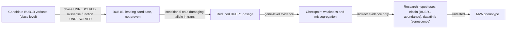

# Track 2 detailed report: approved-drug hypotheses for mosaic variegated aneuploidy (draft)

**Status:** draft for owner approval; not yet submitted. It follows `REPORT_TEMPLATE.md`. **Evidence status:** literature and computational hypotheses only; no experiment was performed. **Patient benefit:** unmeasured. **PatchLens:** not used; no PatchLens output is included. **Nothing here is a diagnosis or a treatment recommendation.**

Fields marked **OWNER** can only be completed by the team. They are left open on purpose.

The detailed evidence is in the companion files of this folder (see `README.md`, "Track 2 index"). This report summarises them and adds no new data.

## 1. Summary

- **Mechanism.** The leading model is loss of BUBR1 dosage through BUB1B. The data contain a known truncating BUB1B allele (an exact-allele ClinVar Pathogenic/Likely pathogenic record; predicted to trigger nonsense-mediated decay) and a rare BUB1B missense change of unknown function. A recessive two-allele explanation needs **both** a damaging missense change **and** trans phase.
- **Status of the mechanism.** BUB1B is the **leading candidate, not a proven cause**. Phase is **unresolved**, and the missense change **cannot be classified as damaging**. TRIP13, CEP57 and CENATAC cannot be ranked against each other. An intronic CEP57 structural signal is **unresolved**.
- **Drug hypotheses.** Twelve approved-drug candidates were assessed. **No candidate has direct evidence of MVA-relevant benefit**, and no drug-repurposing recommendation is supported. Two remain **indirect research hypotheses**:
  - **niacin:** NAD+/SIRT2-dependent BUBR1 abundance; relevant only if residual BUBR1 protein exists;
  - **dasatinib:** senescent-cell clearance; downstream and gene-agnostic.
- **Strongest evidence:** the exact-allele ClinVar assertion for the truncating allele; read-level robustness of the candidate calls; published genetic and related-compound evidence in BubR1 mouse models.
- **Decisive unresolved issue:** the phase of the two BUB1B variants, together with the function of the missense change. Resolving them **changes the drug choice** (section 4).

## 2. Team, repository, disclosures and abstract

| Item | Entry |
|---|---|
| Team name | **OWNER** |
| Team members and contributions | **OWNER** |
| GitHub URL | https://github.com/AIREA-Rare/MVA-Hackathon. It must be public for final evaluation; visibility is an owner action. |
| AI use | Claude Code (Anthropic), model Claude Opus 5.5. Used for analysis scripting, public-API literature and regulatory retrieval, evidence tabulation and drafting. Command output, including variant-level information from the participant's data, was processed by this cloud service. **Plan/tier and data-use settings: OWNER** (a required methods-form answer). The same assistant wrote the analyses and their validation scripts (section 8). |
| Data and consent boundaries | The organiser's single-sample dataset was used under its terms: no redistribution, no recontact of the child, family or MVA Society, deletion of data-bearing material after the event. No patient data, variant notation, coordinate, sample identifier or phenotype list is published here. No secondary or incidental finding is reported. |

### Abstract (≤ 500 words)

We evaluated approved-drug hypotheses for mosaic variegated aneuploidy (MVA) using a participant's whole-genome data, with a mechanism-first approach.

**Variant analysis.** We re-analysed the data at read level (locus-targeted realignment, robustness tests against control heterozygous sites from the same sample, coding callability, structural screens and a phase review). It supports a known truncating BUB1B allele, but it cannot classify a second, rare BUB1B missense change or resolve phase. A biallelic BUB1B mechanism is therefore conditional. Three other MVA genes (TRIP13, CEP57, CENATAC) showed no coding loss of function and could not be ranked against each other, and an intronic CEP57 structural signal remains unresolved.

**Drug assessment.** Twelve previously curated candidates were each tested as a causal chain from drug to target, cellular process, disease mechanism and phenotype. FDA/EMA status was verified, supporting and contradicting literature was recorded, and a documented deterministic ranking rule was applied. No candidate has direct evidence of MVA-relevant benefit. Two approved drugs remain plausible but indirect research hypotheses:
- dasatinib (senescent-cell clearance, a downstream effect);
- niacin (NAD+/SIRT2-dependent BUBR1 abundance, relevant only if residual BUBR1 protein exists).

Antioxidants, proteasome inhibition and spindle poisons are contradicted or potentially counterproductive. Read-through is weak, given the predicted nonsense-mediated decay.

**Experiments.** We provide falsifiable in-vitro designs that separate rescue from growth inhibition, and a minimal functional programme for the missense change. Its interpretation is limited by the scarcity of classified pathogenic BUB1B missense controls.

**Strengths:** explicit uncertainty; evidence labels on every claim; traceable sources with recorded access levels; a pre-declared ranking rule.

**Limitations:**
- literature mostly read at abstract level;
- unresolved phase and missense function;
- no wet-lab data;
- validation scripts written by the same AI assistant as the analyses.

The hypotheses are for follow-up and do not demonstrate efficacy.

## 3. Case evidence allowed for release

- **Phenotype:** not released. A phenotype summary supplied by the team was used at gene level only (`METHODS.md`).
- **Candidate pair:** a known truncating BUB1B allele and a rare BUB1B missense change in the pseudokinase domain. Both are described by class only (`SCIENTIFIC_SUMMARY.md`, "The participant's candidate variants, by class").
- **Phase and technical uncertainty:** both calls have high technical confidence. Phase cannot be resolved from any existing data. A call being real says nothing about function or causality ("Three separate questions for the candidate pair").
- **Causal passport:** not produced for release. The variant-level passport fields are restricted.

## 4. Scientific rationale

**Gene to mechanism.** BUB1B encodes BUBR1, a spindle-assembly-checkpoint protein. MVA1 is autosomal recessive and arises from reduced BUBR1 dosage: null alleles together with abundance- or function-lowering missense alleles, or non-coding second alleles (Hanks et al. 2004; Matsuura et al. 2006; Ochiai et al. 2014; Suijkerbuijk et al. 2010). The consequence is checkpoint weakness and chromosome missegregation. The direction of a correcting therapy is therefore **restore BUBR1 dosage or function**, or **compensate downstream**; never further perturb mitosis.

**Variant to mechanism.**
- **Truncating allele:** loss of function expected (predicted NMD; exact-allele database assertion) but not directly demonstrated. *predicted; database-observed*
- **Missense change:** seven candidate mechanisms were compared (`SCIENTIFIC_SUMMARY.md`, K4).
  - Reduced stability has the most indirect support.
  - "No effect" cannot be excluded.
  - **No mechanism is asserted.**

**Contradictions kept:**
- inheritance (one database entry suggests dominant);
- the BUBR1 pseudokinase role (catalytic versus structural);
- TRIP13 allelic heterogeneity.

**Variant results that change the drug choice:**

| If the variant results show… | Niacin | Dasatinib | Gentamicin |
|---|---|---|---|
| Truncating allele in trans with a hypomorphic missense | **Most relevant** | Ageing-type features only | Only if transcripts escape NMD |
| Missense is a functional null in trans | Little benefit expected | As above | As above |
| Variants in cis, or missense benign | Irrelevant | Only if MVA has another cause | Irrelevant |
| TRIP13, CEP57 or CENATAC causal | Irrelevant | Possibly (gene-agnostic), no evidence | Irrelevant |

## 5. Repurposing eligibility

- **Scope:** only currently approved medicines. A combination needs every component approved and supported, so dasatinib + quercetin is out of scope.
- **Approval checks:** FDA status via openFDA and EMA status via EPAR pages; the results are in `DRUG_HYPOTHESIS_ASSESSMENT.md`, "Regulatory status".
- **Off-label only:** none of the candidates is approved for MVA. Any MVA use would be off-label, and **none is proposed**.
- **Pharmacology and exposure for the two surviving hypotheses** (`DRUG_EVIDENCE_CARD_NIACIN.md`, `DRUG_EVIDENCE_CARD_DASATINIB.md`):
  - niacin raises blood NAD+, but progenitor-cell exposure is unknown;
  - dasatinib has no exposure data in any BUBR1 model.
- **Paediatric label warnings:**
  - dasatinib: growth and development;
  - niacin: muscle and liver.
- **Dosing:** no dose is proposed.

## 6. Candidate selection and rejection

- **Sources:** public databases and literature only, plus the organiser dataset under its terms. No proprietary data. OMIM was not used.
- **Discovery:** primarily manual curation with AI assistance. The candidates came from a curated review. Scripted Europe PMC, openFDA and EMA queries used generic drug, gene and process terms only. No automated drug–target screen generated candidates.
- **Ranking:** a deterministic rule over criteria C0–C7. The full criteria table, the rule and the 12-candidate result are in `DRUG_HYPOTHESIS_ASSESSMENT.md`.

| Category | Candidates |
|---|---|
| Stronger mechanistic hypothesis | none |
| Plausible but indirect | dasatinib; niacin |
| Weak/nonspecific | gentamicin; dactinomycin; somatropin |
| Contradicted or potentially counterproductive | acetylcysteine; bortezomib; vincristine; microtubule poisons, Aurora and PLK1 inhibitors |
| Out of scope (not approved) | NMN, nicotinamide riboside and nicotinamide; ataluren; dasatinib + quercetin |

**Reclassification:** niacin was moved from "rejected" to "plausible but indirect" by the documented criteria. This adds no evidence of benefit.

## 7. Evidence, kept separate by kind

| Kind | What exists |
|---|---|
| Literature | Mostly abstracts read as raw API text. One framework paper (Brnich et al. 2019) in full text. K2-stage pages were tool-summarised (`REFERENCES.md`). |
| Synthetic demo | None for Track 2 |
| Computations on the participant's data | Read-level robustness, coding callability, structural screens, phase review, annotation and NMD rule, ClinVar and gnomAD look-ups, a paralog comparison, a wild-type structure context. Labels: measured, database-observed, predicted. |
| Measured experiments | **None** |
| PatchLens structural evidence (E4) | None |

**Not performed** (`METHODS.md`, "Analyses not run"):
- statistical phasing;
- orthogonal confirmation;
- splice prediction;
- conservation beyond one paralog;
- repeat classification of the CEP57 signal;
- **mutant modelling and ΔΔG** (formal no-go);
- wet-lab work.

## 8. Validation

**Proposed experiments.** All are designs only (`FUNCTIONAL_TEST_DESIGNS.md`). Each states its model, controls, endpoints, replication and falsification criteria.

- **Variant function (B1 and C1):**
  - isogenic knock-in panel: missense/missense, missense/null, WT/null, WT/WT;
  - controls: a benign neighbour, a provisional disease reference and degron depletion;
  - readouts: abundance and half-life, then checkpoint and segregation per division;
  - replication: at least 2 clones and 3 biological replicates; blinded imaging.
- **Other variant tests:** a minigene for the deep-intronic variant (A1); an engineered NMD test (A3).
- **Target engagement and stopping rules for the drugs:**
  - **D2 niacin:** NAD+ → BUBR1 acetylation → BUBR1 level → errors per division. Abolished by SIRT2 loss. Stop if viability falls or BUBR1 does not change.
  - **D1 dasatinib:** senescent fraction falls with **no** increase in missegregation or transformation markers (chromosomal-instability stopping rule).
  - **D3 gentamicin:** a pre-declared stop if there is no full-length BUBR1 above background at non-toxic concentrations.
- **Calibration:** ClinVar holds only one Likely pathogenic BUB1B missense control, against the ClinGen framework's minimum of 11 pathogenic and benign controls in total for moderate evidence. Variant assays can therefore be research-calibrated only.

**Validation of the computations:**
- each stage ran a script that recomputed key results by separate code paths (K2 12 checks, K3 15, K4 13, K5 11, K6 10; all pass);
- a separate audit of K2 corrected one overstatement;
- **the same AI assistant wrote the analyses and the validation scripts, so these show internal consistency, not independent validation.**

## 9. Potential impact and transfer limits

**What this offers:**
- a transparent, mechanism-conditioned map showing which genetic result would make which approved drug worth testing;
- falsifiable designs that separate rescue from growth inhibition.

**What it does not offer:**
- no efficacy claim;
- no patient dosing;
- no claim that the patient's mechanism is established.

**The most relevant next study:** resolve phase and missense function. This needs new material, which is outside the hackathon terms. Then run D2 if a hypomorphic missense allele is in trans.

## 10. Reproducibility and scalability

- **Environment:** bwa 0.7.17-r1188, samtools 1.19.2, bcftools 1.19 and the Python 3.12.3 standard library.
- **Reference data:** GRCh38 analysis set, Ensembl 116, MANE v1.5, UniProt 2026_03, gnomAD v4.1.1, ClinVar release 2026-10-04 and AlphaFold DB v6. Full parameters are in `METHODS.md`.
- **Compute:** one workstation. The three-locus read screen over all FASTQ read pairs took about 4.6 hours.
- **What can be re-derived:**
  - re-running the patient-level analyses needs the organiser's dataset under its terms; the scripts are restricted because they embed restricted inputs;
  - the drug categories can be re-derived by hand from the published criteria table.
- **Scalability:**
  - the locus-targeted read recovery and the deterministic drug rule apply to any gene panel and candidate list;
  - all steps use free tools and the standard library.
- **Effort:** AI-assisted analysis sessions ran from 2026-10-19 to 2026-10-24. Human effort was not recorded (**OWNER** estimate).

## 11. Limitations and the next falsification test

**Limitations:**
- phase unresolved;
- missense function unclassified;
- the deep-intronic variant untested;
- the CEP57 signal unresolved;
- no cytogenetics, so it is unknown whether the cellular phenotype is MVA;
- short-read and locus-recovery blind spots (insertions, balanced events);
- abstract-level literature;
- first-page searches;
- EU national registers not checked;
- validation by the same AI author.

**Alternative explanations kept open** (`SCIENTIFIC_SUMMARY.md`, "Competing explanations"):
- variants in cis;
- an undetected second allele;
- another MVA gene;
- a blended or non-MVA phenotype.

**Next falsification tests:**
- genetic: B1 + C1 (does the missense change lower BUBR1 abundance or function?);
- therapeutic: D2 (does niacin raise BUBR1 through SIRT2 in BUBR1-hypomorphic cells?).

## 12. Privacy, licensing, retention and references

| Item | Status |
|---|---|
| Privacy | Class-level descriptions only. No patient data, identifiers, coordinates, variant notation, allele frequencies or phenotype list. No secondary findings. |
| Licence | **OWNER** (`../NOTICE.md`; it must be compatible with the organiser's CC-BY requirement) |
| Third-party data | Cited, not redistributed. AlphaFold DB content is CC BY 4.0; the structure file is not stored here. |
| Retention and deletion | Restricted inputs and derivatives are deleted after the event under the organiser's terms (team action) |
| References | `REFERENCES.md`, with access levels |
| Pitch video URL | **OWNER** (not part of this repository) |

## Figures

**Causal evidence diagram.** Each arrow is labelled with its evidence status.

**Other figures:**
- **Candidate and rejection table:** section 6, plus "Causal-chain link status" in `DRUG_HYPOTHESIS_ASSESSMENT.md`.
- **Validation design panel:** `FUNCTIONAL_TEST_DESIGNS.md`.
- **Simulated results:** none. No simulated result is shown as a measurement.

## Annex: Track 2 methods-form answers (sheet "Track 2 methods")

These answers are for transfer into the official Excel form. The form itself is not stored here.

| Cell | Question (abridged) | Answer |
|---|---|---|
| A7 | Team name | **OWNER** |
| A8 | Approach from variant or mechanism to medication | Sections 1, 4 and 6. Mechanism-first: read-level variant analysis, then a five-link causal-chain assessment of 12 approved-drug candidates with verified regulatory status and a deterministic ranking rule. |
| A9 | **(Required)** Generative-AI provider, plan or tier, and setting | Claude Code (Anthropic), model Claude Opus 5.5; uses as in section 2. **Plan/tier and data-use setting: OWNER.** |
| A10 | Automated or manual identification | Primarily manual and curated, with AI assistance (section 6) |
| A11 | Manual review and curation | Abstract-level review of primary studies on senolysis in BubR1 mice, NAD+/SIRT2 regulation of BubR1, read-through trials, antioxidant tumour promotion and microtubule-poison missegregation. Each claim is traceable with its access level (`REFERENCES.md`). |
| A12 | Public or proprietary sources | Public only, plus the organiser dataset under its terms |
| A13 | Public sources | openFDA (`drugsfda`, `label`); EMA EPAR pages and the medicines report; Europe PMC; GenCC; ClinVar; gnomAD v4.1.1; UniProt; AlphaFold DB; Ensembl/MANE. OMIM was not used. |
| A14 | Proprietary sources | None |
| A15 | Variant mechanism | Loss of function / dosage model for BUB1B. The truncating allele is predicted NMD-sensitive; missense function is unclassified; phase is unresolved. Reported as conditional, not established (section 4). |
| A16 | Time or effort | **OWNER** (section 10) |
| A17 | Abstract (≤ 500 words) | Section 2, "Abstract" |
